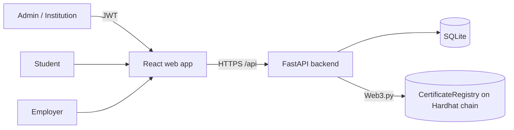
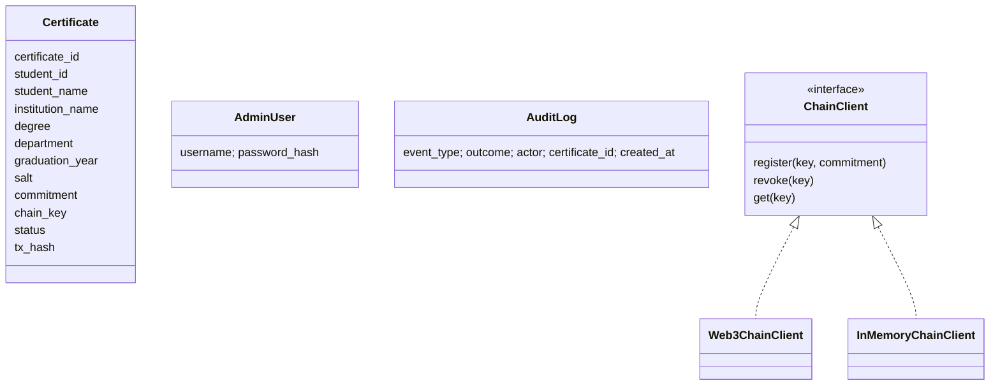
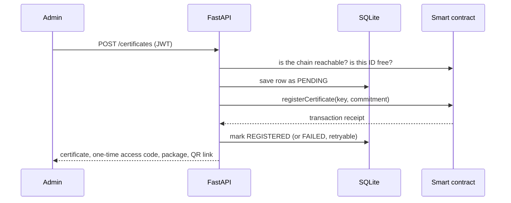
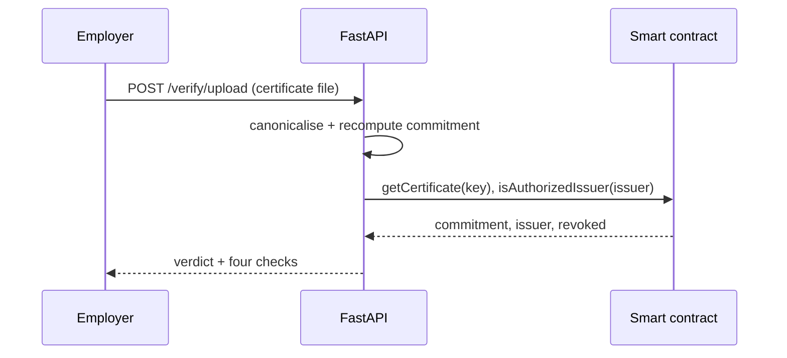
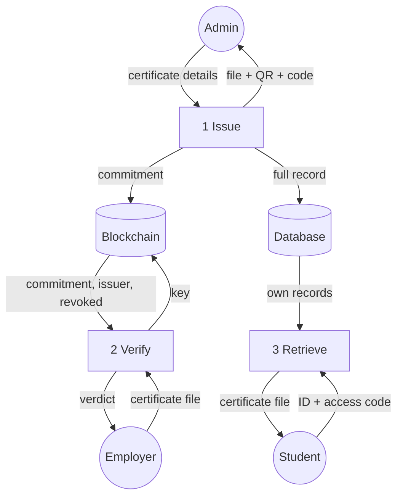

# Architecture

## Components

| Component | Responsibility |
|---|---|
| React web app | Screens for issue, dashboard, audit, verify, student records, system status |
| FastAPI backend | Validation, hashing, authentication, issuing, verification, audit log |
| SQLite | Full certificate details, hashed student access codes, audit events |
| Smart contract | Immutable record of commitment, issuer and revoked flag per certificate |

## Design decisions
- **Hash on-chain, data off-chain.** Personal data is never written to a public ledger. The
  chain holds a salted SHA-256 commitment.
- **Salt.** Student names and IDs have low entropy, so an unsalted hash could be guessed. The
  256-bit random salt prevents that. The salt travels only inside the student's file.
- **Verification reads only the blockchain.** The database is never consulted, so a database
  edit cannot change a verdict.
- **Backend recomputes the hash.** The employer uploads the file; the server derives the
  commitment itself, so a client cannot supply its own hash.

## Class diagram

`InMemoryChainClient` exists only so the automated tests run without a blockchain.

## Issuing sequence

A certificate becomes REGISTERED only after the chain confirms it. If a previous attempt
registered on-chain but failed to update the database, the retry reconciles without sending
a second transaction.

## Verification sequence

## Data flow (level 1)

## Verdicts
| Verdict | Meaning |
|---|---|
| AUTHENTIC_VALID | Registered, hash matches, issuer authorised, not revoked |
| REVOKED | Registered but revoked by the institution |
| UNKNOWN | No record for this certificate ID |
| COMMITMENT_MISMATCH | A record exists but the data does not match it (altered file) |
| INVALID_ISSUER | The registering account has lost its issuer role |
| SERVICE_UNAVAILABLE | The blockchain could not be reached. This is never reported as "invalid" |